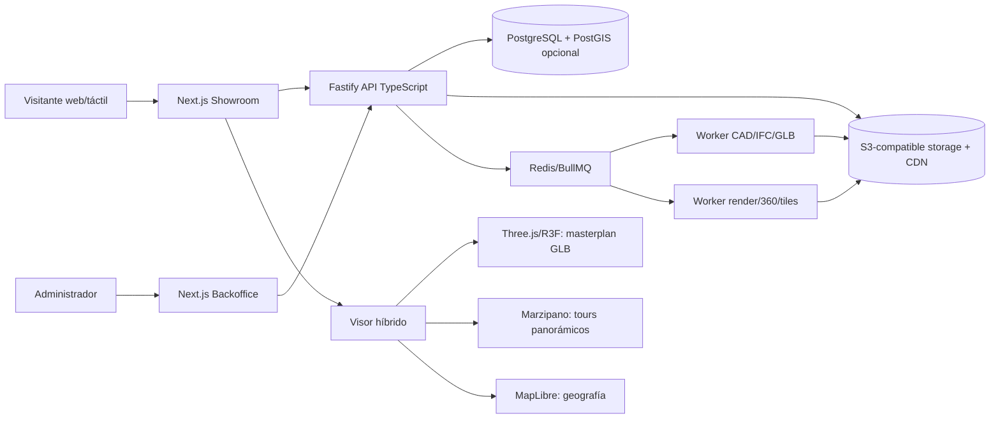

# Arquitectura objetivo — plataforma showroom de arquitectura e inmobiliaria

## Regla de ingeniería
Especificación de una implementación funcional propia del producto visible, no identificación de stack del creador. Priorizar experiencia real y evitar prometer DWG->fotorrealismo automático sin un pipeline validado.

## Diagrama

## Módulos del frontend
- `showroom`: landing de promoción, secciones Inicio/Masterplan/Áreas/Unidades/Galería/Ubicación/Contacto.
- `masterplan`: OrbitControls en Three.js + R3F sobre `GLB`, raycast selección de unidad, pines DOM proyectados, highlight según estado. Si masterplan es solo un conjunto de renders 360, admitir alternativa basada en imágenes sin sacrificar UX.
- `unit-finder`: buscador de viviendas, filtros precio/superficie/dormitorios/estado, detalle con precio y CTA.
- `tour`: Marzipano o equivalente para cubemaps/equirectangulares multi-res; nodos, transiciones, hotspots, flechas, thumbnails, minimapa y botón de regreso al masterplan.
- `floorplan`: plano SVG con nodos de escenas y `viewBox` responsivo; clic navega y sincroniza hotspot activo.
- `map`: MapLibre GL JS y tiles satelitales autorizados/licenciados, pins, POI, distancias y enlaces de ruta.
- `lead`: solicitud de información con consentimiento y anti-spam, notificación.
- `admin`: CRUD de promociones, unidades, estados, galerías, panoramas, ubicaciones/POI, hotspots, hotspots geolocalizados y usuarios.

## Stack recomendado, por decisión de ingeniería
- Next.js + React + TypeScript estricto; Tailwind + shadcn/ui/Radix para formularios accesibles.
- `three`, `@react-three/fiber`, `@react-three/drei` para masterplan realmente interactivo.
- `marzipano` para panoramas interiores multirresolución (comparar con Photo Sphere Viewer para facilidad de plugins). Nunca usar R3F en tours si solo se necesita esfera 360 y el rendimiento resulta peor.
- `zustand` para estado UI y selección; TanStack Query para datos servidor; Zod para validar formatos/API.
- `gsap` opcional para transiciones de cámara; mantener estado serializable.
- `maplibre-gl` para mapas, usando datos/tiles con licencia.
- Fastify + TypeScript (o Nest si el equipo privilegia DI y módulos), Prisma o Drizzle, PostgreSQL, Redis/BullMQ, almacenamiento S3/R2.
- Procesamiento: Blender CLI para glTF y renders offline cuando corresponda; `gltf-transform`, `gltfpack`/meshoptimizer, Draco/KTX2 para optimización; FFmpeg para video y Sharp para imágenes. Validar herramientas y licencias en entorno real.
- Importación: archivos IFC vía IfcOpenShell cuando exista BIM; DWG DXF a través de un proveedor/licencia compatible (ODA File Converter o adaptador comercial) o conversión previa a DXF. No asumir que una geometría DWG contiene materiales, mobiliario, luces ni texturas fotorrealistas.

## Pipeline de contenido recomendado
1. Arquitecto sube DWG/DXF/IFC/GLB y referencias, identifica escala/unidades, pisos, capas, materiales, licencias.
2. Worker hace preflight de formato, malware, dimensiones, unidades, capas/entidades y geometría válida; almacena original inmutable.
3. CAD: DWG -> DXF/IFC/BLEND/GLB según contenido y herramientas con licencia. La extracción de paredes de planos 2D requiere heurísticas y revisión manual; no es un conversor universal.
4. Modelado y enriquecimiento: extrusión/aberturas, techos, materiales, props, iluminación. Puede usar Blender o autoría manual para alcanzar fotorrealismo.
5. Masterplan: exportar GLB LOD, texturas KTX2, meshes instanciados, IDs por vivienda y metadata externa.
6. Interiores: generar panoramas equirectangulares 8K/16K o cubemaps en motor offline (Blender Cycles, Unreal, etc.); convertir a tiles multirresolución.
7. Backoffice: dibujar hotspots/escenas sobre SVG plano, asociar posiciones 3D, revisar transiciones.
8. Publicación: manifest versionado por promoción, CDN, invalidación de assets, caché y rollback.

## Objetos de dominio
- `Organization`, `User`, `Development`, `Building`, `Unit`, `UnitType`, `UnitAvailabilityHistory`, `FloorPlan`, `Scene`, `SceneHotspot`, `PanoramaAsset`, `ModelAsset`, `UnitMeshMapping`, `POI`, `GalleryItem`, `Lead`, `RenderJob`, `ImportJob`, `Asset`, `AuditEvent`.
- Estado de unidad: `AVAILABLE | RESERVED | SOLD | UNLISTED` y precio decimal con código ISO de moneda, histórico de cambios y fecha `updatedAt`.
- Posiciones panorámicas: `(yaw,pitch)` y destino `sceneId`, separadas de coordenadas de modelo `(x,y,z)`.
- `UnitMeshMapping`: mapea `unitId` a nodos/IDs glTF, sin modificar el original.
- Roles: `owner`, `editor`, `sales`, `viewer`; tenant isolation obligatoria.

## API de referencia
`GET /public/developments/:slug/manifest`, `GET /public/developments/:slug/units`, `GET /public/units/:id`, `POST /public/leads`, `GET /public/developments/:slug/poi`; administración autenticada: `POST /admin/import-jobs`, `POST /admin/render-jobs`, `POST /admin/assets/presign`, CRUD para promoción/unidad/escena/hotspot, `PATCH /admin/units/:id/availability`, `POST /admin/developments/:id/publish`, `GET /admin/jobs/:id`. Versionar API.

## Estrategia de render
- Si se trata de panorama: prerender 3D offline -> imágenes 360 -> visor WebGL (barato en GPU, calidad alta, libertad de movimiento limitada a rotación/nodos).
- Si se trata de escena libre: GLB + Three.js/WebGL -> movimiento con OrbitControls y hotspots, calidad depende del hardware; no equivale automáticamente a ray tracing.
- Si se requiere navegación interior libre y fotorrealista: investigar streaming Unreal Pixel Streaming (GPU servidores, costo alto), WebGPU path tracing experimental, o Gaussian Splatting con restricciones de tamaño. NO usar esto en MVP por defecto.
- Conjunto de casas y terreno: 3D interativo con GLB simplificado o sistema multivista/híbrido, POIs DOM con coordenadas ancladas.

## Operación, prácticas y seguridad
- pnpm workspaces (`apps/showroom`, `apps/admin`, `apps/api`, `workers/assets`, `packages/ui`, `packages/domain`, `packages/viewer`).
- Validaciones Zod compartidas, migrations SQL, OpenAPI, tipos generados, Prisma/Drizzle transacciones.
- Signed upload URLs y validación MIME real, límite de tamaño, antivirus, rate limiting de leads, CSRF cuando aplique, headers de seguridad, acceso privado de assets fuente, secrets en vault, GDPR/privacidad.
- Observabilidad: Sentry, métricas API, jobs con retries/backoff idempotentes, dead-letter queue, trazas, auditoría de cambios de disponibilidad.
- Optimización: prefetch escenas adyacentes, tile pyramid para 360, GLB con mallas compactas y geometría instanciada, LOD, KTX2, límite de DPR y modo de baja calidad.
- Pruebas: Vitest para transformaciones y hotspots, Playwright para flujos de navegación y ventas, visual regression con escenas/cámaras fijas, test de estrés para uploads/jobs, tests de permiso por tenant.
