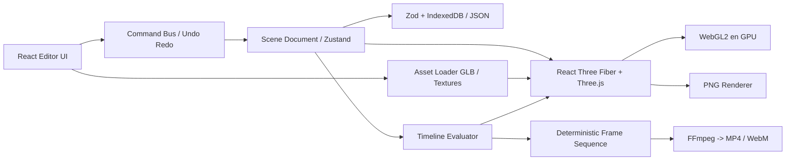

# Arquitectura de referencia — Editor 3D local-first

## Estado de la hipótesis
Este documento presenta **una arquitectura propuesta** para replicar un editor/generador de escenas 3D en navegador. No está verificada como tecnología original del post de Instagram. Si la inspección revela un software distinto, modificar este diseño y registrar la decisión.

## Vista de alto nivel


### Decisiones técnicas
| Área | Elección | Motivo |
| --- | --- | --- |
| Framework | Vite + React 19 + TypeScript | Iteración local rápida y contrato tipado |
| 3D | `three` + `@react-three/fiber` v9 | Scene graph y renderer web integrados con React |
| Helpers | `@react-three/drei` | OrbitControls, TransformControls, Environment, GLTF |
| Efectos | `@react-three/postprocessing` | Bloom, SSAO, DOF (solo si necesarios) |
| Estado | Zustand + Immer | Estado desacoplado del motor y comandos de edición |
| Validación | Zod | Proyecto serializable, versión, datos externos |
| Persistencia | IndexedDB con Dexie o JSON local | Arquitectura local-first; sin backend MVP |
| Animación | evaluador propio de tracks/keyframes por tiempo; GSAP para UI | Scrubbing y render por frame deterministas |
| Importación | `GLTFLoader`, preferir GLB | Formato portable de mallas, cámaras y materiales |
| Geometría avanzada | shaders GLSL, `InstancedMesh`, `BufferGeometry` | Sólo si las referencias lo justifican |
| Físicas | `@react-three/rapier` | Únicamente si hay colisiones/simulación visibles |
| Video | FFmpeg + frames deterministas | Control sobre calidad/fps/códec |
| QA | Vitest + Playwright | Tests lógicos, interactivos y visuales |

**Compatibilidad**: R3F v9 corresponde a React 19; R3F v10 figura como alfa a noviembre de 2026. Evitar v10 en el MVP.

## Interfaz
- Toolbar: nuevo, importar, guardar, exportar, undo/redo, cámara, presets.
- Panel izquierdo: árbol de escena con visibilidad, bloqueo, renombrar y crear/eliminar.
- Centro: viewport WebGL con cámara orbital, grid, gizmo, selección por raycasting, transform controls.
- Panel derecho: transform, geometría, PBR material, iluminación, cámara, efectos.
- Bottom: timeline, playhead, frames/segundo, keyframes y reproducción.
- Feedback: errores explícitos, progreso de carga y límites de GPU.

## Modelo de dominio recomendado
```
Project { id, name, schemaVersion, resolution, fps, durationFrames,
          activeCameraId, entities[], assets[], animationTracks[], renderSettings }
Entity { id, parentId, type, name, visible, locked,
         transform: {position, rotation, scale}, materialId?, geometry?, assetId? }
Asset { id, kind: 'gltf'|'texture'|'hdr', name, mimeType, source, metadata }
Track { id, entityId, propertyPath, interpolation, keyframes: [{frame, value, easing?}] }
RenderSettings { width, height, fps, format, toneMapping, shadows, ... }
```
**Reglas**: IDs estables; serialización JSON; schemaVersion + migraciones; selección/UI efímera fuera del Project; relaciones por ID, no objetos de Three.js en Zustand.

## Organización sugerida
```
src/
  app/                 # AppShell, rutas y proveedores
  features/editor/     # layout, paneles, toolbar, shortcuts
  features/scene/      # árbol, entidades, selección, gizmo
  features/materials/  # inspector PBR, presets
  features/animation/  # tracks, evaluator, timeline
  features/assets/     # import, validación, loading, cache
  features/export/     # PNG, render jobs, secuencia de frames
  engine/              # Canvas, SceneRenderer, camera, lights, helpers
  domain/              # types, Zod schemas, migrations, commands
  store/               # Zustand slices y history
  lib/                 # GPU cleanup, config, file IO
  tests/
public/assets/
```

## Flujo de rendering
1. UI emite comando (`SetMaterial`, `MoveEntity`, `AddKeyframe`) con `entityId` y nuevos valores.
2. Domain valida comando, actualiza documento y guarda transacción para undo/redo.
3. SceneRenderer traduce entidades serializadas a nodos R3F/Three.
4. Runtime compone escena en WebGL2: cámara + luces + meshes + material PBR + sombras.
5. Postprocesado opcional aplica efectos, cuidando color space y tone mapping.
6. Timeline evaluator obtiene valores únicamente de `timeSeconds = frameIndex / fps`, no de tiempo de reloj.
7. Export usa igual evaluador que preview para evitar divergencias.

## Looks y calidad de imagen
- Materiales PBR: baseColor, metalness, roughness, emissive, normal maps; HDRI/Image Based Lighting.
- Sombras: shadow maps con resolución controlada; shadows suaves donde se necesiten.
- Color management: renderer.outputColorSpace = SRGBColorSpace; configurar tone mapping de modo consistente, documentar exposición y evitar doble tone mapping en postprocesado.
- Cámara: perspective/orthographic, focal length/FOV, orbit y presets.
- Efectos activables: bloom, DOF, vignette, antialiasing. Evitar activar todos por defecto.
- Para objetos repetidos usar `InstancedMesh`; limitar luces con sombras simultáneas; mipmaps y compresión de texturas.

## Rendimiento y memoria
- Medir FPS real y P95 frame time en hardware objetivo, no prometer cifras sin test.
- Usar DPR adaptativo para preview; export al tamaño exacto especificado.
- Mantener cache de GLB, texturas; usar Draco/Meshopt/KTX2 solo tras probar soporte y decoder.
- Borrar recursos GPU en unmount/import replace, listeners y controles.
- Carga asíncrona con Suspense y fallback; no bloquear UI.
- Cancelar render jobs de forma segura y limpiar frames temporales.

## Backend opcional (NO incluir en MVP si no hace falta)
- Node.js + Fastify: cola de renders, proyectos multiusuario, API.
- BullMQ + Redis: render jobs y reintentos.
- PostgreSQL: metadatos y proyectos.
- S3 compatible: GLB, texturas, proyectos y outputs.
- Worker con Chromium GPU/FFmpeg o servicio de renders; aislar workloads y validar assets.
- Auth y control de acceso para proyectos privados.

## Alternativas, según la evidencia
- Si el video es 3D offline cinematográfico: Blender + Python + Eevee/Cycles para render; interfaz React como orquestador opcional.
- Si muestra videojuegos, simulación o física compleja: Unreal/Unity/Bevy, no forzar Three.js.
- Si muestra tipografías, formas 2D y motion graphics: Canvas/WebGL shaders, Remotion o un pipeline especializado, sin escena 3D innecesaria.
- Si muestra Gaussian splatting: `three-gaussian-splat` o un renderer de splats, distinto de mallas tradicionales.
